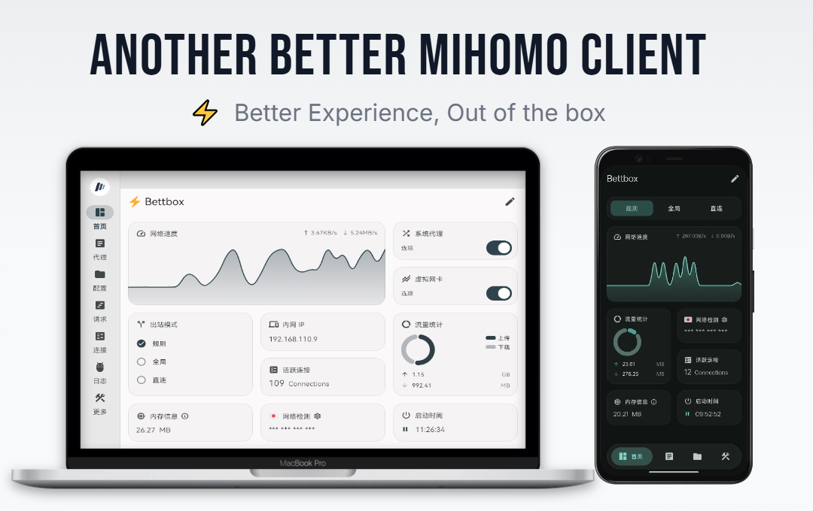

<h4 align="right">
  <a href="../README.md">简体中文</a> | <a href="README_en.md">English</a> | <a href="README_ru.md">Русский</a> | <a href="README_fa.md">فارسی</a> | <strong>日本語</strong> | <a href="README_ko.md">한국어</a>
</h4>

<h1 align="center">⚡ Bettbox</h1>
<p align="center">
  <strong>Another Better Mihomo Client, Forked from FlClash</strong>
</p>

**Bettbox は強力な Mihomo カーネルをベースに深く作り込まれた、マルチプラットフォーム対応のトラフィック分流・DNS デバッグツールです。プライバシー、セキュリティ、そして細部の機能や使い心地を重視し、より優れたクライアント体験の提供に尽力しています（当プロジェクトは Signpath オープンソース財団による人的セキュリティ監査とトレーサビリティ検証をいち早く通過し、Windows 版には OV デジタル署名証明書が適用されています）。**

「Better Experience（より良い体験）」を追求し、オリジナルの洗練された UI を継承しつつ、細部のデザインや複数プラットフォーム向けの実用機能・ロジックを深層最適化。コア機能と実現目標：「フロントエンドは滑らか、バックグラウンドは省電力」。低リソースで長期にわたり安定動作する、より優れた Mihomo クライアントの実現に尽力しています。

Bettbox：Better Experience, Out of the box - 優れた体験を、すぐに使える。

[](https://github.com/appshubcc/Bettbox/releases/latest) [](https://github.com/MetaCubeX/mihomo/releases/latest)

<p align="center">
  
</p>

---
### ✈️ Telegram コミュニティ

</div>

<div align="left">

[](https://t.me/appshub_chat) [](https://t.me/appshub_channel)

---
## 🚀 主な特徴

* **箱から出してすぐ使える**：安定した権限処理と快適な TUN/VPN 体験。最適化プリセット済みで即座に使用可能。
* **洗練されたデザイン**：UI と操作感を隅々まで磨き上げ。高 FPS アニメーション、モバイル低消費電力、デスクトップ低フットプリント。
* **セキュリティ重視**：Mihomo メインラインを追従し、各プラットフォームの最小権限の原則を遵守。さらに SignPath 公式の OV デジタル署名を取得済み。
* **堅牢な安定性**：極端な環境下での境界処理を最適化し、二重の設定検証でエンタープライズ級の安定性を実現。
* **パフォーマンス優先**：デスクトップネイティブ ARM64 サポート、ハードウェア階層化、および Flutter の徹底的な最適化によりハードウェア性能を最大限に引き出します。
* **高度な機能**：マルチプラットフォーム無感スマート起動/停止、Android スリープ対応、ワンタップ QUIC 無効化、機能強化トレイメニュー。
* **ビジュアル設定**：より豊富なパラメータを画面上で視覚的に調整可能。設定ファイルを直接変更することなく即時反映。
* **ホームウィジェット**：洗練されたデザインのウィジェットを複数内蔵。ホーム画面でリアルタイムの通信速度と全体ステータスを一目で把握。
* **カスタマイズ**：豊富なカラーテーマ、カスタムアイコン/タイトル、さらに 30 種類もの美しいスピードテストアニメーションを収録。
* **優れた拡張性**：JS オーバーライドスクリプトに対応した分流 UI 設定と、便利なビジュアルトグルスイッチを初導入。
* **プロ仕様エディタ**：全プラットフォーム対応の高速再構築 code-forge エディタを内蔵し、プロレベルのエディタ体験を実現。
* **レガシー互換**：旧 OS や旧ハードウェア向けの Compatible バージョンを継続維持し、デバイスの寿命を延長。
* **プライバシーリスクゼロ**：オープンソース、広告なし。完全な透明性を持つ CI/CD プロセスは全方位の監査を受け、いかなるバックグラウンドのデータ収集も排除。
* **コミュニティ重視**：フィードバックを真摯に評価し、質の高い Issue を優先対応。ユーザーの声を大切にします。

</div>

###   🛩️ おすすめサービス
#### 中継・専用線  〢  [百変小桜](https://www.bbxy01.com/v2/register?code=c09R)  〢  [白月光](https://www.sibker.com/register?invite_code=YZq6L5zd)  〢  [MESL](https://panel.meslcloud.com/#/register?code=7vy22Bv2)  〢  [Ytoo](https://y-too.net/aff.php?aff=10354)
--------------------------------
#### 低価格・直通  〢  [良心雲](https://xn--9kqz23b19z.com/#/register?code=VTnrQYAj)  〢  [吹雪雲](https://xn--9kqs1lo79d.com/#/register?code=skKMTab7)  〢  [一分](https://xn--4gqx1hgtfdmt.com/#/register?code=AuCiXprV)  〢  [賠銭機場](https://xn--mes358aby2apfg.com/register?code=z7TUZLmM&cover=sfw)
--------------------------------
####   百変小桜限定 32%OFF クーポンコード：bettbox68
--------------------------------

**簡単なレビュー** : ❚ ❚  上記のリンクは主に個人利用またはTGグループでの議論/推奨に基づくもので、アフィリエイト（AFF）としてのみ掲載しています（注：リンク経由での購入により開発者に少額の手数料が還元されます）。サービスの品質を保証・約束するものではありません。諸般の事情をご理解の上、各自で判断・選択してください。

---
## 🛠️ インストールとダウンロード

ご利用のプラットフォームおよびシステムに適した最新のインストールパッケージを **[[Releases]](https://github.com/appshubcc/Bettbox/releases)** ページからダウンロードしてください。


* **全デスクトッププラットフォーム**: 
**Windows 8.1+:** (x64/arm64)
**Linux Kernel 5.4+:** (x64/arm64)
**macOS 12.0+:** (Intel/Apple Silicon)
* **Android 8.0+ 端末**: Android (ARMv8 / ARMv7 / x86_64 / Universal)
* **Android TV**: 完全対応、低メモリ端末向けに ARMv7 32ビット版も選択可能
* **HarmonyOS NEXT**: [[卓易通]](https://harmonyos.cool/android-app) と組み合わせて安定して利用可能

**その他のインストール方法:**<br>
**ArchLinux:** <code>yay -S bettbox-bin または paru -S bettbox-bin</code> ([ lyj404 ](https://github.com/lyj404/bettbox-aur) により維持)<br>
**AMD64=v1:** <code>yay -S bettbox-compatible-bin または paru -S bettbox-compatible-bin</code> ([ VillagerTom ](https://github.com/VillagerTom) により維持)

---
## ❓ よくある質問

1. **インストール・起動およびセキュリティ**：
   - Android端末：**十分なバックグラウンド権限が与えられているか、最低システム要件（Android 8.0+）を満たしているか**確認してください。
   - デスクトップ旧型端末：システムアーキテクチャに応じて**特定 CPU クラス向けの Compatible バージョンが必要か**確認してください。
   - **セキュリティ：Bettbox は完全オープンソースかつ透明で、コードは Signpath のセキュリティ監査に合格しています。**

2. **デスクトップ端末のよくある質問**：
   - Windows管理者権限：Bettbox インストーラー版にて事前処理済みのため、**手動での再権限付与は不要です**。
   - TUN仮想NICを有効化できない：macOS / Linux では**正しいパスワードを入力して権限を授与したか確認してください**。
   - その他のエラー：デバッグ情報を提供し、**競合するプロキシソフトやサービスが動作していないことを確認してください**。
   - 問題が解決しない場合は、ISSUE を提出してください。

3. **macOSインストールの注意事項**：
   - ご利用の環境（Intel / Apple Silicon）に適したファイルをダウンロードし、`Bettbox-macos-xx.dmg` をダブルクリックして開きます。
   - Bettbox アイコンを「Applications」フォルダにドラッグ＆ドロップしてインストール完了。
   - **インストールまたはアップデート時の Gatekeeper 回避**（[現在 Apple デベロッパー証明書を購入していないため](https://support.apple.com/en-us/102445)）：
     - **推奨**：「Applications」フォルダ内で **Bettbox アイコンを右クリック**し、**「開く」** を選択後、確認ダイアログで再度 **「開く」** をクリックします。
     - **代替案**：ダブルクリックで開けない場合は、Mac「システム設定」 -> 「プライバシーとセキュリティ」から Bettbox を探して **「このまま開く」** をクリックします。
   - 初めて TUN モードを有効にする際、パスワード認証ウィンドウが表示されます。**現在ログインしているユーザーのパスワードを入力して Bettbox によるネットワーク構成を許可してください**。

4. **購読リンクをインポートできない**：
   - **まずリンクをリセットして**、正常にアクセスできることを確認してからインポートしてください。
   - 問題が解決しない場合は、まずプロバイダーにお問い合わせください。DEBUG によりアプリ側の原因であると確認された場合は ISSUE を提出してください。

---

## 💻 開発とビルド

Windows の例：

* Windows PC が必要です（OS ≥ Windows 10）
* 必要環境：Git, Visual Studio, Flutter 3.47.x, Golang, Inno Setup, Rust
```bash
* flutter pub get
* dart .\setup.dart windows --arch amd64 --out core (コアのみビルド)
* dart .\setup.dart windows --arch amd64 --out app --compatible (Compatible版オプション)
* ビルド完了後、成果物は `dist/` ディレクトリに生成されます
```

カスタムスクリプト UI 適応：

* v1.18.8 より、Bettbox は外部オーバーライドスクリプトの UI 適応をサポートしています。例えば AIsouler の **[スクリプト/設定リポジトリ](https://github.com/AIsouler/MyClash)** の場合、スクリプトの1行目に以下を追加するだけで、Bettbox 内蔵のトグルスイッチを直接使用できます：
* <code>const Compatible_With_Bettbox = { ruleOptionsEnable: true };</code>

---

### ☕ 開発のサポート（スポンサー）

**プロジェクトがお役に立ちましたら、以下の方法で開発をサポートしていただけます：**

* TRON (TRC-20):   <code>TCkTtZfF2WrciZLaJj3e1aqrh3zdTnCkDa</code>
* Bitcoin: <code>bc1qu950cl6035qvllmzk6cfw3l30j2lg3cq9n6g6h</code>
---

## 🙏 謝辞

<table>
  <tr>
    <td>
      
    </td>
    <td>
    Free code signing on Windows provided by <a href="https://signpath.io">SignPath.io</a>, certificate by <a href="https://signpath.org/">SignPath Foundation</a>
    </td>
  </tr>
</table>

**[FlClash GUI](https://github.com/chen08209/FlClash)** 〢 **[Mihomo Core](https://github.com/MetaCubeX/mihomo)**

すべての [コントリビューター](https://github.com/appshubcc/Bettbox/graphs/contributors) および利用・参考にしたオープンソースプロジェクトに感謝いたします：

[Zashboard](https://github.com/Zephyruso/zashboard), [CMFA](https://github.com/MetaCubeX/ClashMetaForAndroid), [Sparkle](https://github.com/xishang0128/sparkle), [SFA](https://github.com/SagerNet/sing-box-for-android), [HUSI](https://github.com/xchacha20-poly1305/husi), [V2rayN](https://github.com/2dust/v2rayN), [Bett-rules](https://github.com/appshubcc/bett-rules)

---

## 📄 ライセンス

GPL-3.0 ライセンス
